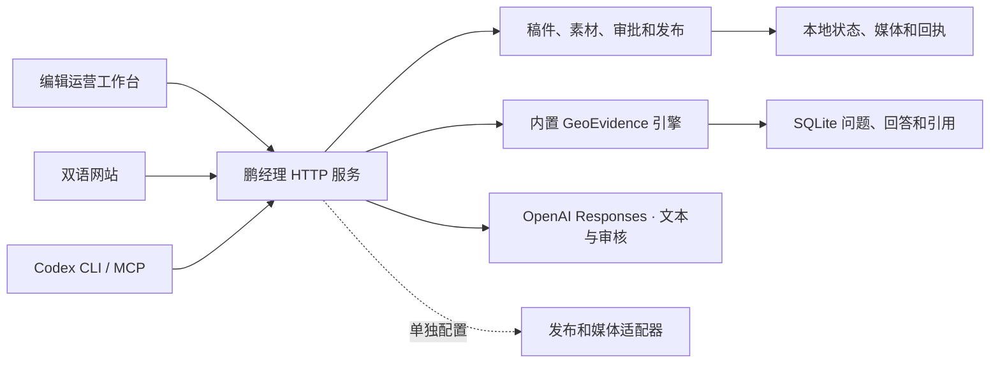

# 鹏经理Codex版 · PengManager Codex Edition

鹏经理Codex版是一套本地优先的内容运营、视频与 GEO 工作台。用 Codex 通过 CLI 或 MCP 发现数字员工、规划图文和视频任务，并沿同一任务查询生产、审核与交付回执。系统内的文本生产使用 OpenAI Responses，默认模型为 `gpt-6.2-sol`。

[English](README.en.md) · [架构](#架构) · [内容发布](docs/CONTENT-PUBLISHING.md) · [Agent 接入](docs/AI-AGENT-GUIDE.md) · [Apache-2.0](LICENSE)

## 能做什么

| 场景 | 怎么用 |
| --- | --- |
| **编辑和出版** | 在管理台管理选题、稿件、素材与审核。网站从已批准的发布版本读取内容，编辑可以回查稿件版本、授权与结果。 |
| **渠道内容运营** | 为不同平台准备渠道稿和交付包。记录发起、审批、结果和回执。真实平台连接器按部署配置和授权启用。 |
| **个人或品牌 GEO** | 保存固定问题、AI 回答、引用和模型出处，在 SQLite 中查看复测与证据。获得授权后，可使用 `pnpm live:codex` 通过已配置的 OpenAI 账户采集。 |
| **媒体与视频接入** | 使用内置原生引擎完成前期、AI 生成、素材剪辑、口播和后期交付。实跑需配置本机工具、媒体供应商与授权素材。 |

## 本地体验

先准备 Node.js 24 和 pnpm 11.25.0。下面的演示使用环回地址和临时数据目录，载入随仓虚构示例。

```bash
git clone https://github.com/geniusdapeng-collab/pengmanager-codex.git
cd pengmanager-codex
pnpm install --frozen-lockfile
pnpm demo
```

- 管理台打开 [http://127.0.0.1:4318/admin](http://127.0.0.1:4318/admin)。
- 查看 [中文网站](http://127.0.0.1:4318/zh) 和 [English site](http://127.0.0.1:4318/en)。
- 端口被占用时，可运行 `PENGMANAGER_DEMO_PORT=4319 pnpm demo`。结束演示按 **Ctrl+C**。

需要持久化时，按[部署说明](docs/DEPLOYMENT.md)启动独立数据目录。演示使用虚构数据和本机回环地址，无需 OpenAI 或媒体供应商账户。

## 用 Codex 启动生产流程

1. 在检出的仓库启动 Codex，让它运行 `pnpm agent:guide` 和 `node scripts/agent.mjs list`。使用 MCP 时，运行 `pnpm agent:config --client codex` 导出配置，在 Codex 中添加该工位，先调用 `pengmanager_agent_guide`。
2. 图文先调用 `pengmanager_editorial_plan` 识别生产线，登记图文任务后用原 job ID 读回。具体部署、图文执行入口和授权见[接入指南](docs/AI-AGENT-GUIDE.md)。
3. 视频先调用 `pengmanager_video_workflow` 和 `pengmanager_video_preflight`。有真实授权、预算和素材的任务使用标准视频 CLI，按同一 job ID 跟进。 [原生视频接入](docs/CODEX-VIDEO-QUICKSTART.md)

Codex 客户端使用自己的登录，应用及授权执行工位需要独立配置 `OPENAI_API_KEY`。用 `PENGMANAGER_CODEX_MODEL` 选择本版登记的 `gpt-6.2-sol` 或 `gpt-6.2-astra`。实际生成视频、口播等媒体还需启用相应供应商和本机工具。 [OpenAI 模型指南](https://developers.openai.com/api/docs/guides/latest-model)

## 架构



| 路径 | 内容 |
| --- | --- |
| [src](src/) | 应用生命周期、HTTP 路由、内容和发布服务、模型路由与视频接入 |
| [public](public/) | 双语网站、编辑运营后台及内容工作台 |
| [engines/geo-evidence](engines/geo-evidence/) | GEO 采集、证据分析、存储与试点查询工具 |
| [data/seed](data/seed/) | 可直接运行的虚构演示数据 |
| [scripts](scripts/) | 本地启动、烟测以及 CLI / MCP 工具 |

## 验证和许可

```bash
pnpm check
pnpm test
pnpm test:engines
pnpm smoke
```

开源版包含网页、服务端、CLI、编辑与交付工作流，以及原生视频引擎。发布版按资源清单校验安装。运营数据、供应商凭据，以及需单独许可的曲库、产品图片和 Live2D 资源由部署者提供。 [视频接入说明](docs/CODEX-VIDEO-QUICKSTART.md) · [测试配置](docs/SOURCE-TEST-PROFILES.md)

鹏经理自有代码采用 Apache-2.0。上游代码、字体与模型配套文件的归属和许可证见 [NOTICE](NOTICE)。安全问题入口见 [SECURITY.md](SECURITY.md)。
