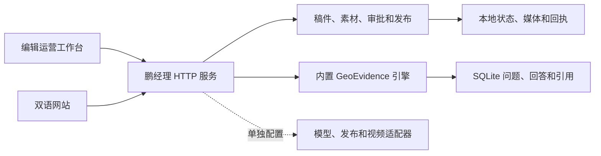

# 鹏经理系统 · PengManager

鹏经理是一套本地优先的内容运营和 GEO 工作台。用它整理中英文稿件、原始资料、配图与审核记录，管理网站发布和渠道交付，并持续观察 AI 回答如何提及和引用关注的主题。

[English](README.en.md) · [架构](#架构) · [内容发布](docs/CONTENT-PUBLISHING.md) · [Agent 接入](docs/AI-AGENT-GUIDE.md) · [Apache-2.0](LICENSE)

## 能做什么

| 场景 | 怎么用 |
| --- | --- |
| **编辑和出版** | 在管理台管理选题、稿件、素材与审核。网站从已批准的发布版本读取内容，编辑可以回查稿件版本、授权与结果。 |
| **渠道内容运营** | 为不同平台准备渠道稿和交付包。记录发起、审批、结果和回执。真实平台连接器按部署配置和授权启用。 |
| **个人或品牌 GEO** | 保存固定问题、AI 回答、引用和模型出处，在 SQLite 中查看复测与证据。随仓示例是虚构数据，联网采集需配置自己的模型和来源。 |
| **媒体与视频接入** | 源码包含内容处理、媒体审核及视频接入层。完整原生视频工作台及其渲染环境需要独立准备。 |

## 本地体验

先准备 Node.js 24 和 pnpm 11.25.0。下面的演示使用环回地址和临时数据目录，载入随仓虚构示例。

```bash
git clone https://github.com/geniusdapeng-collab/pengmanager.git
cd pengmanager
pnpm install --frozen-lockfile
pnpm demo
```

- 管理台打开 [http://127.0.0.1:4318/admin](http://127.0.0.1:4318/admin)。
- 查看 [中文网站](http://127.0.0.1:4318/zh) 和 [English site](http://127.0.0.1:4318/en)。
- 端口被占用时，可运行 `PENGMANAGER_DEMO_PORT=4319 pnpm demo`。结束演示按 **Ctrl+C**。

需要持久化时，参考 [环境变量模板](.env.example) 与 [部署说明](docs/DEPLOYMENT.md)，使用 `pnpm start`。可以使用自己的模型、GitHub 仓库和数据目录。连接器读取当前运行环境，实际发布和模型调用需要自己的账户、权限和审批。

## 架构



| 路径 | 内容 |
| --- | --- |
| [src](src/) | 应用生命周期、HTTP 路由、内容和发布服务、模型路由与视频接入 |
| [public](public/) | 双语网站、编辑运营后台及内容工作台 |
| [engines/geo-evidence](engines/geo-evidence/) | GEO 采集、证据分析、存储与试点查询工具 |
| [data/seed](data/seed/) | 可直接运行的虚构演示数据 |
| [scripts](scripts/) | 本地启动、烟测以及 CLI / MCP 工具 |

## 验证和许可

```bash
pnpm check
pnpm test
pnpm test:engines
pnpm smoke
```

公开仓从经审查的源码快照起步。数据样例可以用于本地体验。运营数据、历史任务或发布记录由各部署实例自己管理。视频源码范围和运行条件见[视频接入说明](docs/CODEX-VIDEO-QUICKSTART.md)。

鹏经理自有代码采用 Apache-2.0。上游代码、字体与模型配套文件的归属和许可证见 [NOTICE](NOTICE)。安全问题入口见 [SECURITY.md](SECURITY.md)。
